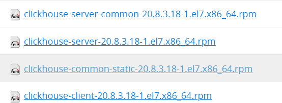
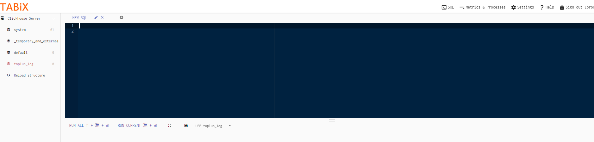
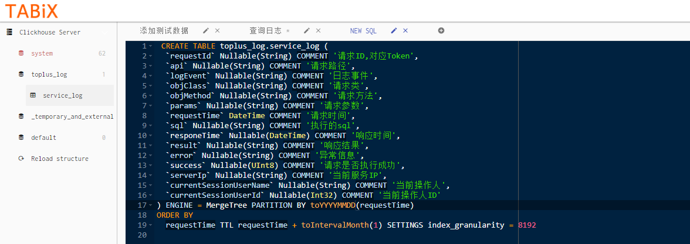
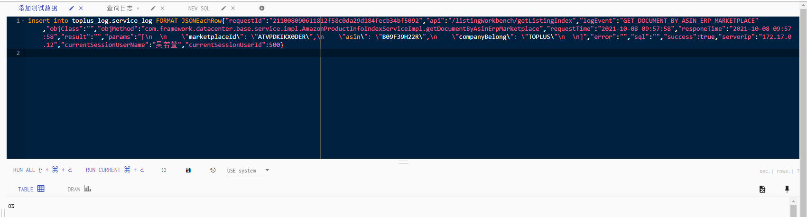
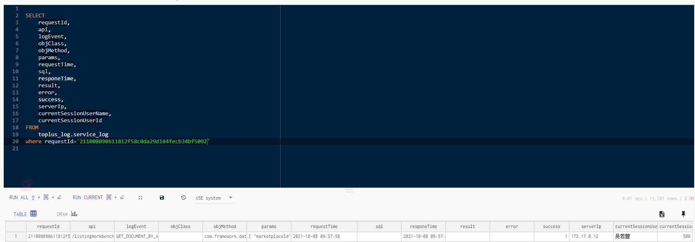

[toc]

# ClickHouse单机部署

## 一、支持的操作系统和硬件环境

**操作系统要求：**

只要是Linux，64位都可以

**Ubuntu**：

优先支持Ubuntu，Ubuntu有官方编译好的安装包可以使用

**Centos和RedHat**：

其次是CentOS和RedHat，有第三方组织altinity编译好的rpm包可以使用

第三方altinity的下载地址：https://packagecloud.io/altinity/clickhouse
需要下载的文件如下：



**其他Linux系统：**

如果是其他Linux系统，需要自己编译源码

具体查看官网：https://clickhouse.tech/docs/zh/getting_started/install/#from-sources

**CPU要求：**

机器的CPU必须支持SSE 4.2指令集

检测机器的cpu是否支持：

检测命令：

```
grep -q sse4_2 /proc/cpuinfo && echo "SSE 4.2 supported" || echo "SSE 4.2 not supported"
```

查询结果：

```
SSE 4.2 supported
```

## 二、配置Linux相关环境设置系统参数

### 1：CentOS取消打开文件数限制

在`/etc/security/limits.conf`、`/etc/security/limits.d/90-nproc.conf`

这2个文件的末尾加入一下内容：

```
* soft nofile 65536
* hard nofile 65536
* soft nofile 131072
* hard nofile 131072
```

### 2：CentOS取消SELINUX

修改`/etc/selinux/config`中的SELINUX=disabled后重启服务器

```
# This file controls the state of SELinux on the system.
# SELINUX= can take one of these three values:
#     enforcing - SELinux security policy is enforced.
#     permissive - SELinux prints warnings instead of enforcing.
#     disabled - No SELinux policy is loaded.
SELINUX=disabled
# SELINUXTYPE= can take one of three two values:
#     targeted - Targeted processes are protected,
#     minimum - Modification of targeted policy. Only selected processes are protected. 
#     mls - Multi Level Security protection.
SELINUXTYPE=targeted
```

### 3:安装ClickHouse相关依赖包

```
yum install openssl libicu unixODBC

yum install -y *unixODBC*
```

### 4:上传安装文件到服务器的/data目录下

```
-rw-r--r-- 1 root root     6384 Sep 29 14:30 clickhouse-client-20.8.3.18-1.el7.x86_64.rpm
-rw-r--r-- 1 root root 69093220 Sep 29 14:31 clickhouse-common-static-20.8.3.18-1.el7.x86_64.rpm
-rw-r--r-- 1 root root 36772044 Sep 29 14:30 clickhouse-server-20.8.3.18-1.el7.x86_64.rpm
-rw-r--r-- 1 root root    14472 Sep 29 14:30 clickhouse-server-common-20.8.3.18-1.el7.x86_64.rpm
```

### 5:执行安装命令

```
rpm -ivh clickhouse-*
```

### 6：启动，验证

启动服务命令：`service clickhouse-server start`

停止服务的命令：`service clickhouse-server stop`

单行模式登录命令行验证：`clickhouse-client`

多行模式登录命令行验证：`clickhouse-client -m；select 1；select now()；`

### 7：ClickHouse目录解释

* `/etc/clickhouse-server` 服务配置文件目录，主要有config.xml，users.xml服务配置文件
* `/etc/clickclient` 客户端配置文件目录
* `/var/lib/clickhouse` 默认数据目录
* `/var/log/clickhouse-server` 日志目录
* `/etc/init.d/clickhouse-server` ClickHouse服务shell脚本文件
* `/etc/security/limits.d/clickhouse.conf` 最大文件打开数
* `/etc/cron.d/clickhouse-server` 定时服务配置
* `/usr/bin` 主程序可执行文件目录

### 8:ClickHouse服务相关参数配置

**1:开放远程访问**

`vim /etc/clickhouse-server/config.xml +70`

```
 <!-- Listen specified host. use :: (wildcard IPv6 address), if you want to accept connections both with IPv4 and IPv6 from everywhere. -->
    <listen_host>::</listen_host> 
    <!-- Same for hosts with disabled ipv6: -->
    <!-- <listen_host>0.0.0.0</listen_host> -->

    <!-- Default values - try listen localhost on ipv4 and ipv6: -->
    <!--
    <listen_host>::1</listen_host>
    <listen_host>127.0.0.1</listen_host>
```

2:设置数据目录

`vim /etc/clickhouse-server/config.xml`

```
<!-- Path to data directory, with trailing slash. -->
    <path>/var/lib/clickhouse/</path>

    <!-- Path to temporary data for processing hard queries. -->
    <tmp_path>/var/lib/clickhouse/tmp/</tmp_path>

    <!-- Policy from the <storage_configuration> for the temporary files.
         If not set <tmp_path> is used, otherwise <tmp_path> is ignored.

         Notes:
         - move_factor              is ignored
         - keep_free_space_bytes    is ignored
         - max_data_part_size_bytes is ignored
         - you must have exactly one volume in that policy
    -->
    <!-- <tmp_policy>tmp</tmp_policy> -->

    <!-- Directory with user provided files that are accessible by 'file' table function. -->
    <user_files_path>/var/lib/clickhouse/user_files/</user_files_path>
```

**3:内存设置限制**

`vim /etc/clickhouse-server/users.xml`

```
        <default>
            <!-- Maximum memory usage for processing single query, in bytes. -->
            <max_memory_usage>2147483648</max_memory_usage> --单次查询的最大内存

            <!-- Use cache of uncompressed blocks of data. Meaningful only for processing many of very short queries. -->
            <use_uncompressed_cache>0</use_uncompressed_cache>

            <!-- How to choose between replicas during distributed query processing.
                 random - choose random replica from set of replicas with minimum number of errors
                 nearest_hostname - from set of replicas with minimum number of errors, choose replica
                  with minimum number of different symbols between replica's hostname and local hostname
                  (Hamming distance).
                 in_order - first live replica is chosen in specified order.
                 first_or_random - if first replica one has higher number of errors, pick a random one from replicas with minimum number of errors.
            -->
            <load_balancing>random</load_balancing>
        </default>
```

## 三、安装ClickHouse可视化工具Tabix

1：先安装nginx 预先安装依赖

```
yum install -y gcc-c++
yum install -y pcre pcre-devel
yum install -y zlib zlib-devel
yum install -y openssl openssl-devel
```

2：下载Nginx安装文件

http://nginx.org/en/download.html

3：解压缩文件，并进行编译安装Nginx

```
cd /data/nginx-1.21.3/
./configure
#如果需要使用https，使用如下命令
./configure --with-http_ssl_module
```

4： 执行make命令

```
make & make install
```

5：修改端口

```
/usr/local/nginx/conf /nginx.conf
```

配置文件中的默认端口为80，可以根据需要设定。

6：Nginx的启动和关闭

确保系统的 80 端口没被其他程序占用，执行命令：

```
/usr/local/nginx/sbin/nginx
```

检查是否启动成功：

```
netstat -ano|grep 80  ## 有结果输入说明启动成功
```

打开浏览器访问此机器的 IP，如果浏览器出现 Welcome to nginx! 则表示 Nginx 已经安装并运行成功。

7：Nginx的重启

```
/usr/local/nginx/sbin/nginx -s reload
```

8：下载tabix，并且上传到服务器

https://github.com/tabixio/tabix/releases/tag/18.07.1

9：配置nginx

```
vim /usr/local/nginx/conf/nginx.conf
```

```
    sendfile        on;
    #tcp_nopush     on;

    #keepalive_timeout  0;
    keepalive_timeout  65;

    #gzip  on;

    server {
        listen       6032;
        server_name  localhost;

        charset utf-8;
        root /data/tabix-18.07.1/build;
        #access_log  logs/host.access.log  main;

        location / {
            if(!-f $request_filename){
               rewrite ^(.*)$ /index.html last;
             }
            index  index.html index.htm;
        }
```

10： 重启Nginx

```
/usr/local/nginx/sbin/nginx -s reload
```

11： 浏览器访问：http://119.29.221.90:6032/



## 四、创建日志存储表



sql如下图所示：

```
 CREATE TABLE toplus_log.service_log (
  `requestId` Nullable(String) COMMENT '请求ID,对应Token',
  `api` Nullable(String) COMMENT '请求路径',
  `logEvent` Nullable(String) COMMENT '日志事件',
  `objClass` Nullable(String) COMMENT '请求类',
  `objMethod` Nullable(String) COMMENT '请求方法',
  `params` Nullable(String) COMMENT '请求参数',
  `requestTime` DateTime COMMENT '请求时间',
  `sql` Nullable(String) COMMENT '执行的sql',
  `responeTime` Nullable(DateTime) COMMENT '响应时间',
  `result` Nullable(String) COMMENT '响应结果',
  `error` Nullable(String) COMMENT '异常信息',
  `success` Nullable(UInt8) COMMENT '请求是否执行成功',
  `serverIp` Nullable(String) COMMENT '当前服务IP',
  `currentSessionUserName` Nullable(String) COMMENT '当前操作人',
  `currentSessionUserId` Nullable(Int32) COMMENT '当前操作人ID'
) ENGINE = MergeTree PARTITION BY toYYYYMMDD(requestTime)
ORDER BY
  requestTime TTL requestTime + toIntervalMonth(1) SETTINGS index_granularity = 8192
```

添加测试数据，验证是否正常：

```
insert into toplus_log.service_log FORMAT JSONEachRow{"requestId":"211008090611812f58c0da29d184fecb34bf5092","api":"/listingWorkbench/getListingIndex","logEvent":"GET_DOCUMENT_BY_ASIN_ERP_MARKETPLACE","objClass":"","objMethod":"com.framework.datacenter.base.service.impl.AmazonProductInfoIndexServiceImpl.getDocumentByAsinErpMarketplace","requestTime":"2021-10-08 09:57:58","responeTime":"2021-10-08 09:57:58","result":"","params":"[\n  \n    \"marketplaceId\": \"ATVPDKIKX0DER\",\n    \"asin\": \"B09F39H22R\",\n    \"companyBelong\": \"TOPLUS\"\n  \n]","error":"","sql":"","success":true,"serverIp":"172.17.0.12","currentSessionUserName":"吴若萱","currentSessionUserId":500}
```



查询测试数据

```
 
SELECT
	requestId,
	api,
	logEvent,
	objClass,
	objMethod,
	params,
	requestTime,
	sql,
	responeTime,
	result,
	error,
	success,
	serverIp,
	currentSessionUserName,
	currentSessionUserId
FROM
	toplus_log.service_log
where requestId='211008090611812f58c0da29d184fecb34bf5092'
 
```



## 五、安装filebeat

filebeat负责收集应用服务的日志文件,并且将日志信息输出到logstash。配置`/data/filebeat-7.8.0-linux-x86_64/filebeat.yml`

```
filebeat.inputs:

# Each - is an input. Most options can be set at the input level, so
# you can use different inputs for various configurations.
# Below are the input specific configurations.

- type: log

  # Change to true to enable this input configuration.
  enabled: true

  # Paths that should be crawled and fetched. Glob based paths.
  paths:
    - /data/framework-provider-sales/logs/service.log
    - /data/framework-provider-datacenter/logs/service.log
  multiline.type: pattern
  # The regexp Pattern that has to be matched. The example pattern matches all lines starting with [
  multiline.pattern: '^[0-9]{4}-[0-9]{2}-[0-9]{2} [0-9]{2}:[0-9]{2}:[0-9]{2}.+?[\}]$'

  # Defines if the pattern set under pattern should be negated or not. Default is false.
  multiline.negate: true

  # Match can be set to "after" or "before". It is used to define if lines should be append to a pattern
  # that was (not) matched before or after or as long as a pattern is not matched based on negate.
  # Note: After is the equivalent to previous and before is the equivalent to to next in Logstash
  multiline.match: before
  
output.logstash:
  # The Logstash hosts
  hosts: ["172.17.0.13:5044"]
processors:
  - add_host_metadata: ~
  - add_cloud_metadata: ~
  - add_docker_metadata: ~
  - add_kubernetes_metadata: ~
  - decode_json_fields:
      fields: ['message'] #要进行解析的字段
```

启动filebeat

```
[root@VM-24-3-centos filebeat-7.8.0-linux-x86_64]# ./filebeat -e -c filebeat.yml
```

## 六、安装logstash-output-clickhouse插件

进入logstash安装目录，执行如下命令：

```
cd /udisk/module/logstash-7.8.0
bin/logstash-plugin install logstash-output-clickhouse
```

## 七、配置logstash

filebeat读取的日志示例如下：

```
2021-09-3014:11:43INFO[http-nio-8582-exec-10]com.framework.common.log.LogAspect[saveLog:101]{\"api\":\"/listingWorkbench/getListingIndex\",\"currentSessionUserId\":400,\"currentSessionUserName\":\"周婉婷\",\"logEvent\":\"GET_DOCUMENT_BY_ASIN_ERP_MARKETPLACE\",\"objMethod\":\"com.framework.datacenter.base.service.impl.AmazonProductInfoIndexServiceImpl.getDocumentByAsinErpMarketplace\",\"params\":\"[\\n{\\n\\\"marketplaceId\\\":\\\"ATVPDKIKX0DER\\\",\\n\\\"asin\\\":\\\"B08X2CRF3G\\\",\\n\\\"companyBelong\\\":\\\"SLXC\\\"\\n}\\n]\",\"requestId\":\"21093009074606500c83be3d93e4d02aeed44a39\",\"requestTime\":\"2021-09-3014:11:43\",\"responeTime\":\"2021-09-3014:11:43\",\"serverIp\":\"172.17.0.12\",\"success\":true}
```

logstash从filebeat读出日志文件，经过解析截取，最终将日志信息写入到Kafka，具体配置如下：

```
input {
      beats {
        port => "5044"
        client_inactivity_timeout => 3000
    }
}
filter {
   grok{
       match => { 
		"message" => "(?<temp_message>(\{.+?[\}]$))"#截取出现{到以}结尾的字符串 
	}
   }
   mutate {
       rename => {"temp_message" => "message"}
       # 移除不必要的默认字段
       remove_field => ["host"]
       remove_field => ["agent"]
       remove_field => ["ecs"]
       remove_field => ["tags"]
       remove_field => ["fields"]
       remove_field => ["@version"]
       remove_field => ["@timestamp"]
       remove_field => ["log"]
       remove_field => ["input"]
       remove_field => ["type"]
       # 设置字段的默认值
       add_field => {
		   "requestId" => ""
		   "api" => ""
		   "logEvent" => ""
		   "objClass" => ""
		   "objMethod" => ""
		   "params" => ""
		   "requestTime" => "%{+YYYY-MM-dd HH:mm:ss}"
           "responeTime" => "%{+YYYY-MM-dd HH:mm:ss}"
		   "result" => ""
           "sql" => ""
		   "error" => ""
		   "success" => "true"
		   "serverIp" => ""
		   "currentSessionUserName" => ""
		   "currentSessionUserId" => ""
	  }
   convert => ["success", "string"]
   }
# 以json格式输出
  json {
        source => "message"
  }
  mutate {
     remove_field => ["message"]
     gsub => [ "params","{","" ]
     gsub => [ "params","}","" ]
 }
}


output {
       
        #kafka {
        #bootstrap_servers => ["172.17.0.13:4501,172.17.0.13:4502,172.17.0.13:4503,172.17.0.13:4504,172.17.0.13:4505"]
	#topic_id => "toplus_service_log"
        #batch_size => 1000
        #codec => "json"
      	#security_protocol => "SASL_PLAINTEXT"
        #sasl_mechanism => "PLAIN"
        #sasl_jaas_config => "org.apache.kafka.common.security.plain.PlainLoginModule required username='admin'  password='vH&37KM.?d9F.s';"
	#  }
     clickhouse {
        http_hosts => ["http://172.17.0.11:8123/"]
        table => "toplus_log.service_log"
        request_tolerance => 1
        mutations => {
           requestId => requestId
		   api => api
		   logEvent => logEvent
		   objClass => objClass
		   objMethod => objMethod
		   requestTime => requestTime
		   responeTime => responeTime
		   result => result
		   params => params
           error => error
           sql => sql
		   success => success
		   serverIp => serverIp
		   currentSessionUserName => currentSessionUserName
		   currentSessionUserId => currentSessionUserId
        }
      flush_size => 10000
    } 
    #stdout {
    #    codec => rubydebug
    #}

}
```
